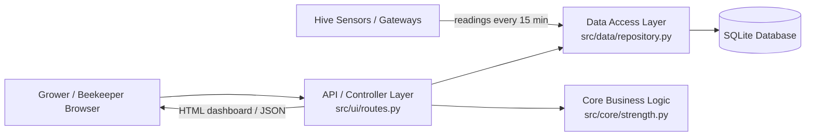

# System Architecture

## 1. Architectural Style
- Pattern: N-Tier Layered Architecture (Presentation -> Core Logic -> Data Access) in a single deployable container (modular monolith).
- Rationale: The prototype has one team, a fixed bloom deadline and a small scope, so a single service is simpler to build, test and deploy than microservices. Keeping the layers separate means the strength model in `src/core` can be retrained or replaced without touching the dashboard, and the SQLite repository can later be swapped for a cloud database behind the same interface as the system scales from the pilot (20 hives) to all 200 hives.

## 2. Component Interaction Diagram (Mermaid)

## 3. Data Flow & Execution Lifecycle
1. Ingestion: Each hive sensor sends weight, temperature and sound readings every 15 minutes through a field gateway. The data access layer stores each reading as a row in the `readings` table (simulated by `seed_demo_data()` in the prototype).
2. Processing: When a user opens the dashboard or calls `/api/hives`, the controller asks the repository for the latest reading per hive. The core layer converts each reading into an estimated number of frames of bees, checks it against the 8-frame contract minimum and assigns a status (OK, WATCH or ALERT).
3. Persistence & Response: Readings stay in SQLite as the history used for the end-of-season compliance report. The controller returns the results as an HTML dashboard (Jinja2 template) or as JSON.

## 4. Architecture Decision Records (ADRs)
- ADR-01 (Layered monolith over microservices): Context: small team, one deployable, fixed April 30 go-live. Decision: one Flask service with separate UI, core and data packages. Trade-off: less independent scaling, accepted because 200 hives at one reading per 15 minutes is a small load.
- ADR-02 (SQLite for the prototype): Context: the prototype needs storage with no server to manage. Decision: SQLite through a repository class. Trade-off: not suited to many concurrent writers; the repository interface allows moving to PostgreSQL for production.
- ADR-03 (Containerised deployment with Docker): Context: the team develops on different machines and the system must run the same way in the cloud. Decision: package the app as a Docker image published to Docker Hub. Trade-off: adds an image build step to each release.
